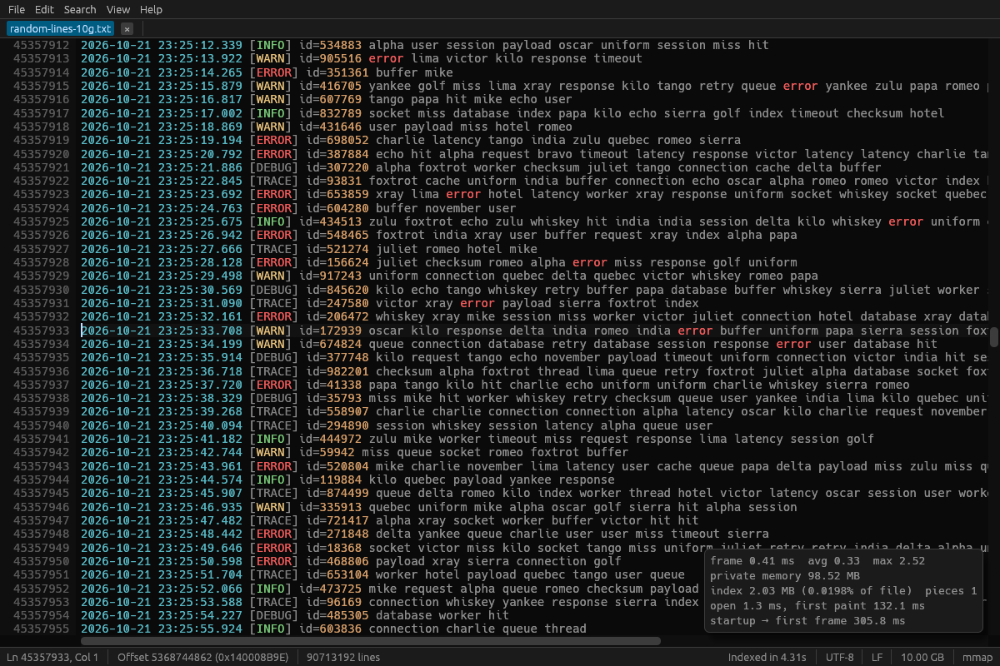
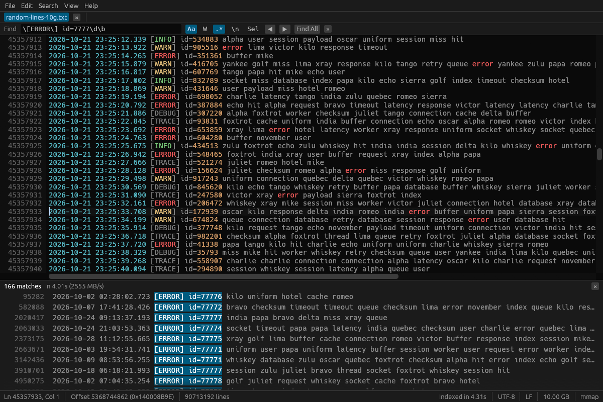
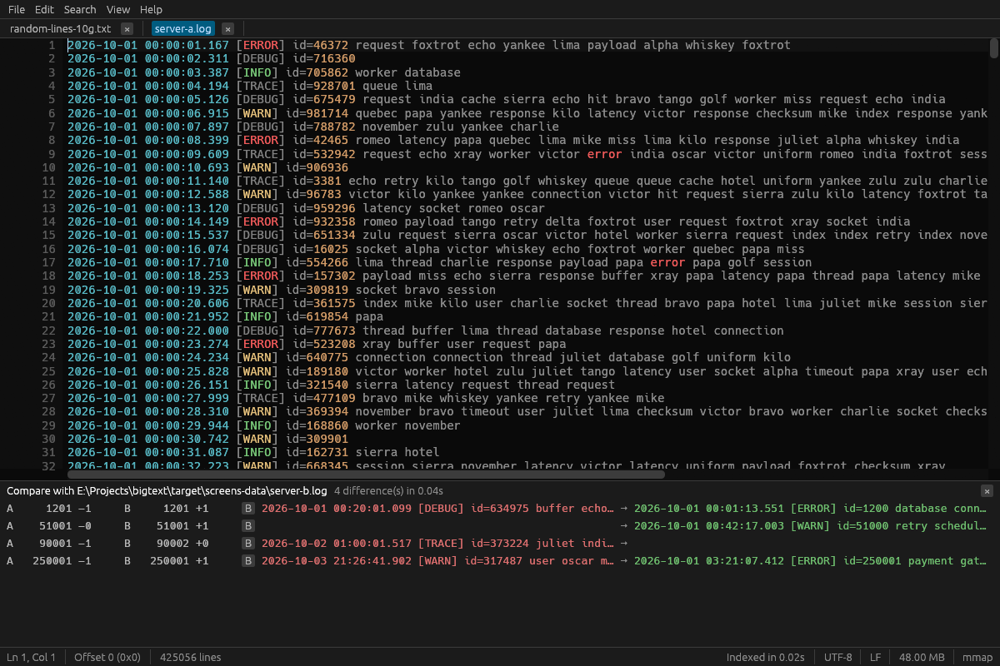
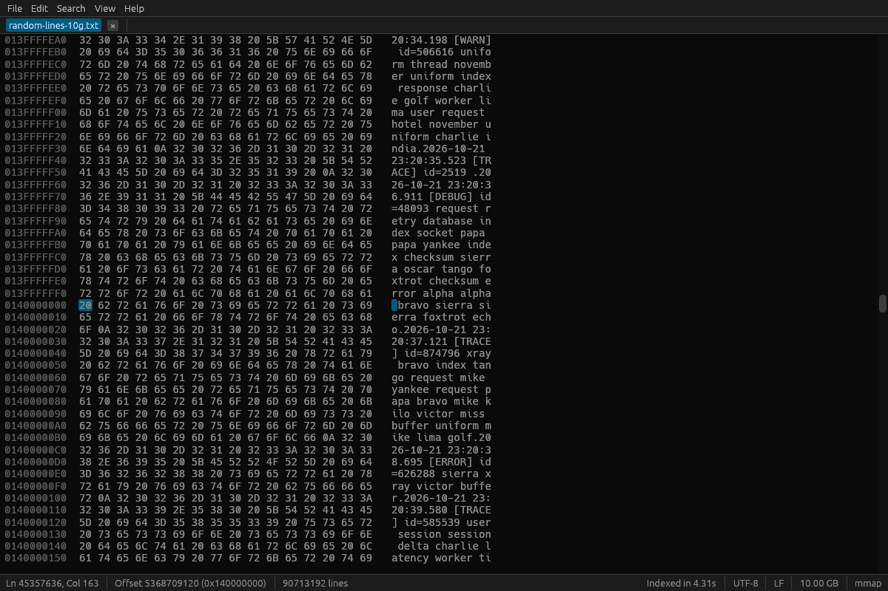
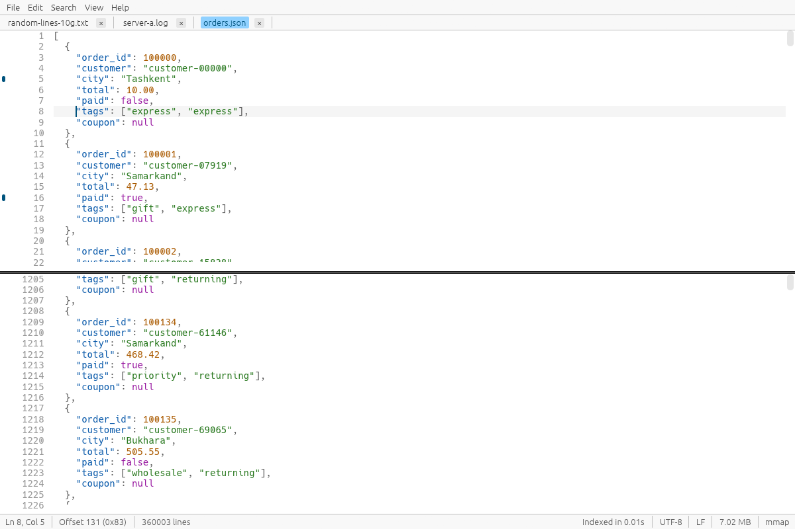

# BigText — fast text editor for huge files (1–50+ GB)

[](https://github.com/Erkinbek/bigtext/actions/workflows/build.yml)
[](https://github.com/Erkinbek/bigtext/releases/latest)
[](LICENSE)
[](https://erkinbek.github.io/bigtext/)

**Open, search and edit 1 GB, 10 GB and 50 GB text and log files instantly.** BigText is a free,
open-source desktop text editor for **huge files** — logs, CSV exports, SQL dumps, JSON — that
never freezes and never loads a whole file into memory. Files of any size open in milliseconds
and stay responsive; search, replace, edits and saving run on background threads with progress
and cancellation.

**[Website](https://erkinbek.github.io/bigtext/)** · **[Download](#download)** · [Русский](https://erkinbek.github.io/bigtext/ru/) · [O'zbekcha](https://erkinbek.github.io/bigtext/uz/)



Written in Rust with a custom virtualized text view on top of `egui`/`eframe` (glow renderer).
Single self-contained binary, no runtime dependencies.

## Features

- **Open anything**: File → Open, drag & drop, command line (`bigtext file.txt`), Windows
  "Open with" (registered by the installer), multiple tabs.
- **Never reads the whole file**: a small cache of memory-mapped views for the visible text,
  positional streaming reads for background work; network/removable drives (or mmap failure)
  fall back to buffered chunked reads served from a cache by a loader thread, so a slow drive
  can never stall the UI.
- **Sparse, incremental line index**: one `u64` per 64 KB, built in the background from the top.
  Go to line and the scrollbar work immediately (estimated positions, shown with `~`, refined
  when the index catches up).
- **Compressed files** (`.gz`, `.zst`, also multi-member/multi-frame as log rotators write
  them): unpacked once, streaming, into a temporary copy (with progress and cancel) that then
  opens like any other file. The copy is read-only; Save becomes Save As. It is deleted when
  the tab closes, and the session remembers the compressed file.
- **Encodings**: BOM, UTF-8, UTF-16 LE/BE (with or without BOM), heuristic Windows-1251 /
  Windows-1252 / ISO-8859-1; File → Reopen with encoding. Invalid bytes show as U+FFFD, control
  characters and NUL as dim placeholders. **File → Save with encoding** writes a copy in
  UTF-8 (with or without BOM), UTF-16 LE/BE, Windows-1251/1252 or ISO-8859-1, streaming
  (with the line-ending conversion if one is chosen); characters the target cannot represent
  become `?` and are counted in the message. Binary-looking files open as text with a one-click
  **hex view**.
- **Line endings**: LF / CRLF / CR / Mixed detection in the status bar, optional conversion on
  save.
- **Huge lines**: a single 2 GB line, minified JSON, base64 — lines longer than 64 KB are
  soft-broken (`↪` in the gutter) so every row computation is bounded; horizontal
  virtualization renders only the visible slice.
- **Search** (Ctrl+F): plain text or regex (linear-time `regex-automata`), case sensitive,
  whole word, multiline (dot matches newline), search in selection. Streams over the mmap on a
  worker with a live counter and cancel; F3 / Shift+F3 work before any full search finishes;
  "Find All" results in a virtualized list (capped at 1,000,000 with a "more exist" note), with
  **Top values…** (the different matched texts or a capture group counted, most frequent first,
  like `grep -o | sort | uniq -c`) and **Save matches…** (only the matched texts);
  matches highlighted in the viewport only. Non-UTF-8 files are searched by transcoding the
  pattern (literal) or decoding windows (regex) with exact byte mapping. Matches spanning
  chunk or piece boundaries are found.
- **Filter view** (Ctrl+Shift+F, or **Filter** in the search bar): only the lines with a match
  — or, with **!**, the lines without one — in a virtualized list under the text, like `grep`
  over the whole file. **±N** in its header adds N dimmed lines before and after each match
  (`grep -C`), and **Whole entry** keeps a log entry together: the stack trace under an ERROR
  line, or the entry's first line above a match inside a trace. The **Narrow** row adds
  conditions on top (`timeout`, then without `healthcheck`), shown as chips that can be removed;
  narrowing a finished filter reads only its lines. Click a line to jump to it.
  **Save lines…** streams every kept line to a
  new file (no limit); **Copy lines** puts them on the clipboard (up to 100 MB). Find All
  results offer the same two buttons.
- **Highlights** (View → Highlights…, or **Mark** in the search bar): patterns painted in their
  own colours in every document — `ERROR` in red, a request id in blue — kept across sessions.
  Selecting a word (double click) also highlights its other occurrences on screen.
- **Scrollbar marks**: Find All matches, filter lines, bookmarks and the differences from
  File → Compare are marked on the vertical scrollbar, so you see where they cluster in a 50 GB
  file at a glance.
- **Go to time** (Ctrl+Shift+T): type `14:32:05` or `2024-05-01 14:32:05` to jump to the first
  log line at or after that time. A binary search over byte offsets reads only a few hundred
  KB, so it is instant even before indexing finishes. Recognises ISO 8601, `DD.MM.YYYY`,
  `MM/DD/YYYY`, Apache `[01/May/2024:14:32:05`, syslog `May  1 14:32:05` and bare times, with
  milliseconds. When a selection spans timestamped lines, the status bar shows the time
  between its first and last line (**Δt**).
- **Search history**: the ▾ button next to the find field, or Up/Down inside it, brings back
  recent patterns (kept across sessions).
- **Replace** (Ctrl+H): replace current / replace all with `$1`, `${name}`, `\n`, `\t`. Up to
  50,000 matches are applied as one undoable piece-table edit; beyond that the result is
  streamed to a temp file and swapped in atomically (optional `.bak`), with bounded memory and
  progress/cancel. Preview of the first 200 replacements.
- **Editing**: piece table over the mmap + add buffer; insert/delete, cut/copy/paste (copies
  above 100 MB ask first and run on a worker), undo/redo, multi-line selection, duplicate line
  (zero-copy), delete line, auto-indent, large-file-safe Select All.
- **Crash-safe save**: stream to a temp file in the same folder → fsync → atomic replace
  (`ReplaceFileW` on Windows, keeps attributes/ACLs). Any failure leaves the original intact;
  "file in use" / permission errors produce clear messages. Save As, optional `.bak` backup
  (File → Keep backup), unsaved-changes prompts. Closing the window during a save waits for a
  clean cancel or for the atomic swap to finish.
- **Status bar**: line and column of the caret, byte offset, the number of lines (exact once
  indexing has finished, `~` before), and for a selection its lines, characters (up to 4 MB)
  and bytes, the time it spans in a log (Δt) and the width of a block selection.
- **Other**: line numbers, zoom (Ctrl+wheel), word wrap (off by default), light/dark theme,
  read-only toggle (auto for read-only files), external change detection with Reload, and a
  **follow (tail) mode** for growing logs that resumes indexing where it stopped.
- **Column (block) selection**: Alt+drag selects a rectangle. Copy copies it line by line;
  typing, Backspace, Delete and Tab change every row at once (one undo step); pasting as many
  lines as the block has rows puts one on each row. Works without word wrap, up to 10,000
  rows.
- **Text operations** (Edit → Text) on the selection, or on the whole document up to 64 MB:
  sort lines (A→Z, Z→A, by leading number), reverse, remove duplicate lines, UPPER / lower
  case, trim trailing whitespace, tabs ↔ spaces, and JSON pretty-print / minify (token by
  token: key order, numbers and escapes stay as written; JSON Lines stay one value per line).
  Runs on a worker and is one undo step.
- **Font** (View → Font…): the monospaced fonts installed on the system (Consolas, Cascadia,
  JetBrains Mono, DejaVu Sans Mono, Menlo, …) or any `.ttf`/`.otf`/`.ttc` file, with a preview
  and a warning for fonts that are not monospaced; the built-in font stays as the fallback
  for missing characters. Kept across sessions.
- **Interface languages**: English, Russian and Uzbek (View → Language), kept across sessions.
  A unit test checks that every interface text has both translations with the same
  placeholders. Error details that come from the operating system stay in English.
- **Command palette** (Ctrl+Shift+P): type a few letters of any command (menus, views, text
  operations) and press Enter. **Help → Keyboard shortcuts** lists every command with its key;
  click a key and press a new one to change it (a key taken from another command is moved,
  with a note). Changes are kept across sessions.
- **Bookmarks** (Ctrl+F2, F2 / Shift+F2) that stay on their lines while you edit.
- **Split view** (Ctrl+\\): two panes over one document with independent scrolling.
- **Syntax highlighting** for logs, JSON, XML/HTML, CSV/TSV, SQL and INI/TOML/YAML — computed
  only for the visible slice of the visible rows; View → Highlight as overrides the extension.
- **CSV / TSV table view**: `.csv` and `.tsv` files open as a table (View → Table view or
  Ctrl+T switches any file between table and text). The delimiter (comma, semicolon, tab, pipe)
  is detected from the first lines and can be changed in the toolbar; quoted fields follow
  RFC 4180. The first row is a pinned header, numbers align right, columns fit their content
  (drag a header border to resize, double-click it to fit again). Like the text view it reads
  only the rows on screen, so a 10 GB CSV scrolls as fast as a small one. Click a cell to put
  the caret there, double-click it to edit it in the text view.
- **Delete CSV columns**: click column headers to select them (Ctrl+click adds, Shift+click
  selects a range), then **Delete columns** (or the Delete key) removes them and their values
  from every row, after a confirmation that names them. Files up to 64 MB change as one undoable
  edit (Ctrl+Z); larger files are rewritten on disk like Replace All (temp file, atomic swap,
  optional `.bak`) in one streaming pass with bounded memory.
- **Export and split** (File menu): **Export lines…** writes a line range (say 100,000–200,000)
  to a new file, **Save selection as…** writes the selection, and **Split file…** cuts the
  document into `name.part001.ext`, `name.part002.ext`, … of a given size in MB or number of
  lines, always at line breaks (UTF-16 parts each get the byte order mark). All of them
  stream on a worker with progress and Cancel in the status bar.
- **CSV column tools** (right-click a column header in the table view): sort rows ascending or
  descending (numbers numerically, text ignoring case, empty values last, header kept; files
  up to 1 GB), **Statistics…** (rows, empty, distinct values, numeric sum/mean/min/max and the
  most frequent values, in one streaming pass), **Filter rows by this column** (the filter
  then only counts matches inside that field), **Rename…**, **Move left/right**, and **Export**
  the column or the selected columns to a new CSV. Like Delete columns, changes to files up
  to 64 MB are one undo step; larger files are rewritten on disk (temp file, atomic swap,
  optional `.bak`).
- **Compare files** (File → Compare with…): streaming line diff of two huge files with bounded
  memory; identical stretches are skipped at memory speed (1 GB vs 1 GB with two changed lines:
  0.6 s, ~2 MB of memory). Click a difference to jump there in either file; F7 / Shift+F7 step
  through them; **Compare with tab ▸** picks another open file; Swap A↔B turns it round.
  It can ignore white space, case, timestamps and a mask regex (`bigtext diff -w -i -t --mask`).
  Unsaved edits are compared too; **Compare with the saved file** shows what you changed
  before Ctrl+S, **Compare with the backup (.bak)** what the last save changed.
  **View → Compare side by side** shows the other file beside the document: removed lines red
  with −, added green with +, the changed part of a changed line brighter, and the two panes
  scroll together (the pane under the pointer leads).
  **Save as .diff…** in the compare panel writes a standard unified diff (3 lines of context,
  streamed, any size); **File → Apply patch…** applies a .diff/.patch to the document as one undo
  step, finding a hunk up to 4,096 lines away when it matches only one place there and listing
  the hunks it could not place.
- **Log tools**: a **level bar** above logs (ERROR / WARN / INFO / DEBUG lines in the filter view,
  F8 / Shift+F8 to the next / previous error); **Search → Time histogram** (Ctrl+Shift+H), a bar
  chart of lines and errors per second, minute, hour or day, click a bar to go there;
  **File → Merge logs by time…**, several logs in timestamp order with each line labelled in its
  file's colour. Timestamps: ISO 8601 with time zones, Unix seconds / milliseconds, syslog,
  Apache, Java and .NET formats with AM/PM; hovering a Unix time shows it as a date.
- **Follow an id**: request, trace, span and session ids on the caret's line (`request_id=…`,
  `"traceId": "…"`, bare UUIDs) show as chips in the status bar; a click or Ctrl+Shift+I filters
  the file to that id's whole log entries and shows when it was first and last seen, how long it
  took and how many errors it had. **Search → Id patterns…** edits the keys.
- **Log fields** (View, Ctrl+Shift+L): the caret's JSON Lines or logfmt (`key=value`) line as a
  key → value table that follows the caret (nested objects as `user.id`, escaped stack traces
  shown as lines). Each field can filter the file to its value or away from it, highlight it,
  or **count its values** over the whole file into a table (lines, share, first and last time).
- **Time range**: the search bar's **Time** button sets "from 14:30 to 14:35" (or ±30 s / ±5 min
  around the caret's line); Filter, Find All and the level bar then read only those lines, found
  with two binary searches instead of a full pass.
- **Message patterns** (Search → Message patterns…): the log's lines grouped by template —
  timestamps dropped, numbers, hex ids, UUIDs, IPs and paths replaced by `<n>`, `<hex>`,
  `<uuid>`, `<ip>`, `<path>` — with counts and levels, most lines first (the noise) or rarest
  first (the anomalies); a click shows only that template's lines.
- **Time gaps** (Search → Find time gaps…): every place where the next timestamp is at least N
  seconds later — or earlier, when the clock went back — largest first; click one to go there.
  The status bar shows **Δ** since the previous timestamped line for the caret's line.
- **Find in files** (Search, Ctrl+Alt+F): the pattern in every `*.log` (or any pattern) file of a
  folder and its sub-folders, listed as `file:line`; click to open the file there.
- **Saved searches** (★ in the search bar): a pattern with its options, `!` and column under a
  name, applied as a filter with one click.
- **Multiple cursors**: Ctrl+D adds the next occurrence of the selection, Alt+click adds a
  cursor; typing, paste, Backspace, Delete, Enter and Tab change the text at all of them.
- **Matching brackets and tags** highlighted next to the caret; Ctrl+] jumps to the partner.
  **View → Show whitespace and line breaks** shows spaces, tabs and LF / CRLF / CR.
- **JSON and XML**: **View → Structure** (Ctrl+Shift+J), an outline opened node by node (fine for a
  root array of millions of items, or an XML element tree), jumping to a path like `$.items[1234].id`
  (or `/catalog/item[1234]/price`) and copying the
  path at the caret; **View → Open JSON Lines as table**.
- **Field queries over JSON Lines** (the search bar's **{}**): `.level == "error" and
  .duration > 500` in the filter view (`bigtext-cli jsonl -q`).
- **Convert**: a JSON array to JSON Lines and back, and logfmt (`key=value`) logs to a table
  (File menu, `bigtext-cli convert`).
- **Check JSON** (Search): strict checking of a JSON document or of JSON Lines line by line, with
  the problems listed and clickable (`bigtext-cli validate`).
- **JSON fields…** (View): every key path of JSON records with types, counts, nulls, number
  ranges and examples; copy as a JSON Schema sketch (`bigtext-cli stats --fields`).
- **Compare JSON with…** (File): two JSON files compared by structure, key order and formatting
  ignored (`bigtext-cli jsondiff`).
- **Tables find their header**: Excel's `sep=;` line, comment and title lines before the table
  are skipped (and kept as they are by sorting and other rewrites), and a table of numbers is
  shown without a header row. The toolbar's **Table…** menu sets the lines to skip and the quote
  (`"` or `'`).
- **Freeze and hide columns** in tables (a header's right-click menu): frozen columns stay on the
  left while the rest scroll; hidden ones leave the view, not the file.
- **Join tables** (File → Join tables…): the rows of one table with the matching rows of another,
  by a key column, as a new table (`bigtext-cli join`).
- **Pivot tables** (a column's menu → Pivot by this column…): rows by one column (or by hour, day
  or month), columns by another, counts or sums in the cells (`bigtext-cli pivot`).
- **Add column…** from an expression over the row (`{price} * {qty}`, `substr({ts}, 0, 10)`,
  `if(…)`, `regex(…)`), previewed as you type (`bigtext-cli derive`).
- **Chart…** of a column: the distribution of its numbers, times or most frequent texts as bars
  under the table; a bar filters the rows to it.
- **Check rows…** (a column's menu, or View → Check table rows…): every record with another field
  count, a stray or unclosed quote, a control character or text in a number column, listed under
  the table with its line; **Save rows…** writes them to a file.
- **More table tools**: **Group rows by this column…** (counts, with sums of another column),
  **Filter rows by conditions…** (several conditions at once), and export as JSON, JSON Lines,
  Markdown or Excel (.xlsx).
- **Tabs and sessions**: Ctrl+Tab in most-recently-used order, pinned tabs, close other tabs /
  tabs to the right, drag to move; **File → Sessions** saves the open files with positions,
  bookmarks, pins, filters and highlights under a name; **Edit → Copy file:line**
  (Ctrl+Shift+C) for `bigtext path:line`.
- **Recent files and session restore**: tabs, positions, bookmarks and settings come back on
  the next start (state in `%APPDATA%\BigText\state.txt` / `~/.config/bigtext`). **Portable
  mode** keeps them in a `BigText-data` folder next to the program instead (Help → Portable
  mode…), and **Help → Export / Import settings** carries highlights, key bindings, saved
  searches and the look to another computer.
- **Updates**: once a day BigText asks GitHub for a newer release (Help → Check for updates
  does it on demand; Help → Check for updates automatically turns it off). A dialog shows the
  release notes of every newer version and installs nothing until you choose **Update now**;
  **Skip this version** stops the reminders until the next release. The download is checked
  against its size and the SHA-256 that GitHub publishes. An installed copy runs the new
  installer silently when BigText closes; a portable copy (zip, tar.gz) swaps its executable in
  place. **Restart now** reopens your tabs in the new version. A `cargo install` copy shows the
  command to run instead.

## Screenshots

| Regex search over 10 GB (2.5 GB/s) | Comparing two logs |
| --- | --- |
|  |  |
| **Hex view in the middle of a 10 GB file** | **Light theme, JSON, split view, bookmarks** |
|  |  |

The screenshots are made by the app itself: `bigtext --screenshots DIR testdata/random-lines-10g.txt`.

## Download

Latest release: [all files and release notes](https://github.com/Erkinbek/bigtext/releases/latest) · [changelog](CHANGELOG.md)

| Platform | Download |
| --- | --- |
| Windows 10 / 11 | [Installer](https://github.com/Erkinbek/bigtext/releases/latest/download/bigtext-setup-windows-x64.exe) (adds “Open with” and an Explorer context-menu entry) · [portable .zip](https://github.com/Erkinbek/bigtext/releases/latest/download/bigtext-windows-x64.zip) |
| Linux x64 | [bigtext-linux-x64.tar.gz](https://github.com/Erkinbek/bigtext/releases/latest/download/bigtext-linux-x64.tar.gz) |
| macOS | [Apple Silicon](https://github.com/Erkinbek/bigtext/releases/latest/download/bigtext-macos-arm64.tar.gz) · [Intel](https://github.com/Erkinbek/bigtext/releases/latest/download/bigtext-macos-x64.tar.gz) (unsigned: right-click → Open on first launch) |

With Rust installed, on any platform: `cargo install bigtext`
([crates.io/crates/bigtext](https://crates.io/crates/bigtext); on Linux, first install the
packages listed under [Building](#building)). Or build it yourself (see [Building](#building)).

## Usage

```
bigtext [OPTIONS] [FILE[:LINE] ...]

  FILE:LINE        open FILE at line LINE (FILE:LINE:COLUMN, as compilers and grep -n
                   print it, works too)
  -                read standard input, following it as it grows
                   (e.g.  journalctl -f | bigtext -)
  -n, --line N     go to line N in the last file
  --find TEXT      search for TEXT (from the start, or from --line)
  --regex RE       search for a regular expression
  -f, --follow     follow the files as they grow, like tail -f
  -h, --help       show this help
```

For scripts, **`bigtext-cli`** (in every download; `bigtext --filter …` works too) runs the
same streaming code without a window:

```
bigtext-cli filter [-v] [-i] [-w] [-E] PATTERN FILE [-o OUT]   lines with (-v: without) a match
bigtext-cli levels ERROR,WARN FILE [-o OUT]                    lines of these log levels
bigtext-cli count [-v] [-i] [-w] [-E] PATTERN FILE             number of matching lines
bigtext-cli extract [-E] [-g N] [--count] PATTERN FILE          only the matched texts (or counts)
bigtext-cli split (--size 100MB | --lines N) FILE [--out-dir DIR]
bigtext-cli stats FILE...                                      size, lines, encoding, first/last time
bigtext-cli merge FILE FILE... [-o OUT]                        logs merged by time
bigtext-cli convert FILE --to json|jsonl|md|xlsx|csv [-o OUT]  tables (and JSON Lines → CSV)
bigtext-cli validate FILE [--no-header] [--numeric 3,5]        malformed CSV / TSV rows
bigtext-cli values FIELD FILE [-o OUT]                         a JSON Lines / logfmt field's values
bigtext-cli gaps FILE [--min 30s]                              time gaps, with line numbers
bigtext-cli patterns FILE [--top N] [--rare] [-o OUT]          message templates with counts
```

`filter` and `count` take more patterns: `-e PAT` (each must match, or one of them with `--any`)
and `--not PAT`. `filter` and `levels` take `-A N` / `-B N` / `-C N` (lines after / before / around each match),
`--entries` (whole log entries) and `-n` (line numbers, `12:` a match and `13-` context), with
`--` between groups like grep, and `--from TIME` / `--to TIME` (only the lines between two
times). Exit codes: 0 done, 1 nothing matched, 2 error.

| Shortcut | Action |
|---|---|
| Ctrl+O / Ctrl+N | Open / new |
| Ctrl+S / Ctrl+Shift+S | Save / save as |
| Ctrl+W | Close tab |
| Ctrl+1 … Ctrl+8, Ctrl+9 | Tab 1 … 8, the last tab |
| Ctrl+PageDown / Ctrl+PageUp | Next / previous tab in the bar |
| F4 / Shift+F4 | Next / previous entry of the list under the text (Find All, filter, Find in files) |
| Ctrl+Tab / Ctrl+Shift+Tab | Tabs in most-recently-used order (hold Ctrl, release to switch) |
| Ctrl+F / Ctrl+H | Find / replace (Enter = next, Shift+Enter = previous, Esc = close) |
| F3 / Shift+F3 | Find next / previous |
| Ctrl+Shift+F | Filter: show only the lines with a match |
| Ctrl+Alt+F | Find in files |
| F8 / Shift+F8 | Next / previous error line (or line of the levels shown) |
| Ctrl+Shift+H | Time histogram |
| Ctrl+Shift+I | Follow the id at the caret (or the selected text) |
| Ctrl+Shift+L | Log fields of the caret's line |
| Ctrl+] | Go to the matching bracket or tag |
| Ctrl+Shift+J | JSON structure |
| Ctrl+Shift+C | Copy file:line |
| Ctrl+Shift+P | Command palette |
| Alt+Left / Alt+Right | Back to where the caret jumped from / forward again (also the mouse's side buttons) |
| Ctrl+G / Ctrl+Shift+G | Go to line / go to byte offset (decimal or `0x` hex; also `50%`, `+100` / `-100` from the caret, `$-100` from the end) |
| Ctrl+Shift+T | Go to time (first log line at or after a timestamp) |
| Ctrl+Z / Ctrl+Y (Ctrl+Shift+Z) | Undo / redo |
| Ctrl+X / Ctrl+C / Ctrl+V | Cut / copy / paste |
| Ctrl+A | Select all |
| Ctrl+D | Select the word, then add its next occurrence as another cursor |
| Alt+click | Add a cursor (Esc: back to one cursor) |
| Ctrl+Shift+D / Ctrl+Shift+K | Duplicate line (or selection) / delete line |
| Ctrl+←/→, Ctrl+Backspace/Delete | Word movement / delete word |
| Home / End, Ctrl+Home / Ctrl+End | Line start (smart) / end, document start / end |
| Ctrl+wheel, Ctrl+= / Ctrl+- / Ctrl+0 | Zoom |
| Alt+Z | Toggle word wrap |
| Ctrl+F2 / F2 / Shift+F2 | Toggle / next / previous bookmark |
| Ctrl+\\ | Split view |
| Double / triple click | Select word / line |
| Alt+drag | Column (block) selection |
| F12 | Performance overlay (frame time, private memory, index size) |

View → Hex view, View → Follow (tail), View → Syntax highlighting, File → Open recent,
File → Compare with…, File → Reopen with encoding, File → Line endings on save,
File → Keep backup (.bak) on save, Edit → Read-only, Help → About.

## Building

The workspace builds four binaries: `bigtext` (the editor), `bigtext-cli` (the script
commands), `bigtext-bench` (core benchmarks) and `gen-testfiles` (test corpus generator).
`packaging/` has the Linux `.deb` / AppImage and macOS `.app` scripts and Homebrew templates.

### Windows (MSVC)

1. Install [Rust](https://rustup.rs) (`stable-x86_64-pc-windows-msvc`) and the Visual Studio
   Build Tools with the "Desktop development with C++" workload.
2. `cargo build --release` → `target\release\bigtext.exe` is the portable executable.
3. Optional installer: install [Inno Setup 6](https://jrsoftware.org/isinfo.php), then
   `ISCC.exe /DSourceExe=%CD%\target\release\bigtext.exe installer\bigtext.iss`
   (adds Start-menu entry, "Open with" registration and an Explorer context-menu item).

### Linux

```
sudo apt-get install libxkbcommon-dev libwayland-dev libxcb-render0-dev libxcb-shape0-dev libxcb-xfixes0-dev libgl1-mesa-dev
cargo build --release
```

### macOS

Install the Xcode command line tools, then `cargo build --release` (Apple silicon), or
`rustup target add x86_64-apple-darwin && cargo build --release --target x86_64-apple-darwin`.

### CI

[.github/workflows/build.yml](.github/workflows/build.yml) builds Windows x64, Linux x64 and
macOS arm64/x64, runs the unit tests and uploads the binaries plus the Windows installer
(`bigtext-<version>-setup.exe`) as artifacts of every run. The installer was checked with a silent
per-user install (`/VERYSILENT /CURRENTUSER`): files, "Open with" and Explorer context-menu
entries and the Start-menu shortcut are created, the installed exe runs, and the uninstaller
removes all of it.

## Architecture

```
src/
  file.rs           Source: cached mmap views + positional reads | chunked (block cache + loader) | empty
  encoding.rs       Encoding, Codec (newline search/count, decode/encode, char boundaries), detection
  index.rs          LineIndex: one u64 per 64 KB, background indexer, estimates
  text/buffer.rs    TextBuf: piece table (original mmap + add buffer), line<->offset mapping, undo swaps
  text/rows.rs      bounded visual segments (64 KB soft breaks), wrap, cell math
  search.rs         Matcher (memmem / regex-automata / decoded), windowed streaming search
  replace.rs        templates, batch edits, streaming replace-all
  save.rs           temp file + fsync + atomic replace (ReplaceFileW), EOL conversion
  diff.rs           streaming line diff (chunk compare + hashed re-synchronisation)
  jobs.rs           cancel tokens, progress, wakers
  app/              egui shell: tabs, menus, search panel, results list, dialogs, save protocol,
                    session/recent files, compare panel
  view/             custom virtualized text view, hex view, syntax highlighting
  self_test.rs      in-app GUI self-test driven by synthetic input
  bin/              gen-testfiles, bigtext-bench
```

Key decisions (details in [PLAN.md](PLAN.md)):

- The view is anchored to a **byte offset**, not a line number, so it never depends on the
  index. Scrollbars are proportional to bytes.
- **Rows are bounded**: lines are soft-broken every 64 KB, so finding the row around any offset
  reads at most 128 KB. Nothing on the UI thread scans unbounded data.
- **Threading**: the UI thread only reads the visible bytes. Opening + detection, indexing,
  search, find-next, replace, save, large copies and file watching run on workers that hold
  cheap `Arc` snapshots of the piece table and report through channels.
- **Saving on Windows** requires the file to be unmapped before it can be replaced: the worker
  writes and fsyncs the temp file from a snapshot, the UI then drops its mapping, and a
  finalize worker waits until no snapshot holds the old file, swaps it in and reopens it. If
  that fails the original (untouched) file is reopened and the edits are re-attached.
- Undo history is cleared after a save (the old mapping it refers to is released). Undoing
  back to the last saved state clears the modified marker.

## Tests and benchmarks

```
cargo test --lib --bins              # 80 unit tests: index, piece table, rows, search, replace, save,
                                     # encodings, diff, highlighting, session file, updates, CSV
cargo test --lib update -- --ignored # downloads and unpacks the latest release (needs the network)
target/release/bigtext --self-test --report report.txt [--screenshot shots/x.png]
                                     # 59 GUI checks with synthetic mouse/keyboard/clipboard input
scripts/gen-testfiles.ps1            # or scripts/gen-testfiles.sh; -SkipBig / --skip-big avoids the 10 GB file
target/release/bigtext-bench FILE    # core benchmarks (open, first screen, go-to, index, search, replace, memory)
target/release/bigtext --bench-ui FILE --report out.txt [--screenshot out.png]
        [--scenario search:TEXT|edit|view|wrap|hex|close-search|close-replace]
```

The **GUI self-test** drives the real window through `App::raw_input_hook`: clicks, drags,
double/triple clicks, shift-click, keys and shortcuts, typing, copy/paste, Ctrl+wheel. It checks
selection, smart Home/End, auto-indent, undo/redo back to the unmodified state, clipboard,
duplicate/delete line, zoom, find / F3 / Shift+F3 / Find All, replace all + undo, go to line and
offset, atomic save (no temp files left), the unsaved-changes prompt, wrap/hex/overlay toggles,
bookmarks, split view, highlighting, file comparison, the CSV table (column selection, delete
and undo), the About window, and these edge cases:
read-only files (edits blocked; saving over one fails cleanly and keeps the edits), a file
appended to while open (banner, then follow mode), a file renamed or deleted while open, a
path longer than 260 characters (open, edit, save), a Unicode path, the chunked read path
(forced, and via `\\localhost\E$` UNC), empty / no-trailing-newline / CR-only / BOM-in-the-middle
/ UTF-16 / Windows-1251 files, a binary file, and a 6 MB copy on a worker. Every run: 56/56
passed, max UI frame time 3–5 ms. The `close-search` / `close-replace` scenarios close the window
mid-job: the process exits within a second, no temp file is left and the original file's hash
is unchanged.

The generator writes `random-lines-1g.txt`, `random-lines-10g.txt`, `single-line-2g.txt`,
`utf16le.txt`, `cp1251.txt`, `binary.bin`, `mixed-eol.txt`, `short-lines-100m.txt` and small
edge cases (empty file, no trailing newline, CR-only, BOM in the middle, NUL + invalid UTF-8,
Unicode path).

## Website

The project website ([erkinbek.github.io/bigtext](https://erkinbek.github.io/bigtext/)) lives in `docs/` and is served by
GitHub Pages from the `main` branch. It is generated in English, Russian and Uzbek by
`python scripts/build-site.py` (needs Pillow), which also converts the screenshots in
`target/shots` to WebP and draws the logo, favicons and the social preview image:

```
target/release/bigtext --screenshots target/shots testdata/random-lines-10g.txt
python scripts/build-site.py
```

## Releasing

1. Bump the version in `Cargo.toml`, `installer/bigtext.iss` and `scripts/build-site.py`, add
   the release to [CHANGELOG.md](CHANGELOG.md), run `python scripts/build-site.py --no-images`
   and commit.
2. Push a tag: `git tag -a v0.1.2 -m "BigText 0.1.2"` and `git push origin v0.1.2`.
3. CI builds every platform and publishes a GitHub release with version-free asset names
   (so `releases/latest/download/<file>` links keep working, and the in-app updater finds
   `bigtext-setup-windows-x64.exe`, `bigtext-windows-x64.zip` and the `.tar.gz` files by these
   names). Write the changes under a `## What's new in 0.1.2` heading in the release notes: the
   update dialog shows that section (and the whole notes when there is no such heading). Then:
   - **crates.io** (`crates-io` job) publishes the crate with
     [trusted publishing](https://crates.io/docs/trusted-publishing), so no token is stored.
     It runs when the repository variable `CRATES_IO_PUBLISH` is `true`. One-time setup: the
     first version is published by hand (`cargo login`, then `cargo publish`); then on crates.io
     → bigtext → Settings → Trusted Publishing add the repository `Erkinbek/bigtext` with the
     workflow `build.yml`.
   - **winget** (`winget` job) opens a pull request with the new version at
     [microsoft/winget-pkgs](https://github.com/microsoft/winget-pkgs) through
     [WinGet Releaser](https://github.com/vedantmgoyal9/winget-releaser). It needs the secret
     `WINGET_TOKEN` (a classic token with the `public_repo` scope) and a fork of winget-pkgs
     under the repository owner, and it only updates a package that is already in winget: the
     first version is submitted by hand from the manifests in `packaging/winget/`, which pass
     `winget validate`. Until that submission is merged the job skips itself.

## Measured performance

Measured on Windows 11 Pro, Intel Core Ultra 9 285 (24 cores), 191 GB RAM, release build,
files already in the OS page cache ("cached data" as in the targets). GUI numbers come from
`bigtext --bench-ui` (frame time = CPU time of one egui frame including our layout); core numbers
from `bigtext-bench`. Raw reports: `scripts/bench.ps1` reproduces them.

### Targets

| Target | Goal | Measured | |
|---|---|---|---|
| Open → first screen of text | < 200 ms | 41–46 ms in the GUI (1 GB … 50 GB, incl. waiting for the next frame); open + detect on the worker 1.2–2.4 ms; first-screen layout 0.03 ms | ✅ |
| Jump to line, indexed (10 GB / 50 GB) | < 50 ms | frame incl. jump + layout: avg 0.86 / 0.88 ms, max 1.31 / 1.22 ms; core lookup + 50-row layout avg 0.07 ms | ✅ |
| Jump to line before indexing (estimate) | < 500 ms | frame avg 1.40 / 1.60 ms, max 1.82 / 2.01 ms (refined automatically when the index arrives) | ✅ |
| UI frame time while indexing / scrolling | < 16 ms | page-down every frame while indexing 50 GB: avg 0.83 ms, p99 1.16 ms, max 1.88 ms (600 frames); 2 GB single line: max 2.68 ms | ✅ |
| Literal search throughput | ≥ 1 GB/s | 2.4–2.5 GB/s (10 GB, 50 GB), 4.4 GB/s (2 GB line), case-insensitive 1.7–2.1 GB/s | ✅ |
| Simple regex throughput | ≥ 200 MB/s | `id=99\d{4} ` 2.3–2.8 GB/s, `ERROR\] id=\d+ timeout` 2.3 GB/s, no-literal `[a-z]{9,} [a-z]{9,}` 672 MB/s; decoded UTF-16 / cp1251 regex 390 / 248 MB/s | ✅ |
| Replace All on 10 GB, private memory | < 300 MB | 22.2 M replacements, 10 GB written in 11.3 s (904 MB/s incl. fsync), peak private 46 MB | ✅ |
| Idle private memory, 50 GB file open | < 200 MB | 107 MB in the GUI after indexing (≈95 MB of it is the GUI/GL baseline); core process 12 MB | ✅ |
| Startup → first paint | < 300 ms | 159–185 ms (process start → end of first frame) | ✅ |

### Details

| File | Index time (throughput) | Index memory | Lines |
|---|---|---|---|
| random-lines-1g.txt | 0.45 s (2.3 GB/s) | 130 KB | 9,069,553 |
| random-lines-10g.txt | 4.1–4.3 s (2.4–2.5 GB/s) | 2.0 MB | 90,713,192 |
| random-lines-50g.txt | 19.2–23.1 s (2.2–2.7 GB/s) | 8.1 MB (0.016 % of file) | 453,565,956 |
| single-line-2g.txt | 0.76 s (2.7 GB/s) | 260 KB | 1 |
| short-lines-100m.txt | 0.18 s (2.6 GB/s) | 65 KB | 100,000,001 |
| utf16le.txt (64 MB) | 0.02 s | 8 KB | 690,320 |
| cp1251.txt (64 MB) | 0.03 s | 8 KB | 1,091,711 |

- Chunked fallback (forced, 1 GB): first screen 3.1 ms, search 3.0–3.6 GB/s, private memory
  67 MB (64 MB block cache).
- 2 GB single line: page-down frames avg 1.87 ms, go-to 0.45 ms, search finds the marker in the
  middle at 4.4 GB/s.
- Save of an edited 1 GB file (edit at the top while indexing was still running): 0.9–1.1 s for
  write + fsync + atomic replace + reopen.
- Memory design note: mapping a whole 50 GB file on Windows commits ~100 MB up front (file
  size / 512), so the UI maps a small LRU cache of 288 MB views and workers stream with
  positional reads into reused buffers. That keeps memory flat, and makes indexing faster than
  first-touch page faults (2.4 vs 1.6 GB/s); repeated searches run at ~2.4 GB/s instead of the
  ~10 GB/s an already-faulted full mapping would allow.

## Known limitations

- Regex matches are exact up to 1 MB of length across window edges; longer matches are found
  by re-searching with a growing window, capped at 256 MB (longer matches are reported
  truncated). A match longer than 1 MB that only ends past the overlap may be reported from a
  later start than strict leftmost-first semantics would give.
- Column numbers inside soft-broken lines (> 64 KB) are byte-based estimates (`Col ~N`).
- A CR-only line break is recognised only in files without LF line breaks (mixed CR is shown
  as a `←` placeholder).
- Wide (CJK) characters are drawn by the font but laid out as one cell; the default fonts do not
  include CJK glyphs.
- On Linux/macOS, another process truncating a file while it is mapped can raise SIGBUS
  (inherent to mmap; Windows forbids truncating mapped files). Network drives use chunked reads.
- Syntax highlighting is row-local: a string or comment that spans lines is not tracked.
- The CSV table shows one line per row, so a quoted field that contains line breaks appears as
  several rows (the text is unchanged). Deleting columns reads whole records and handles such
  fields correctly.
- The file comparison compares lines by 64-bit hash + length (a collision would hide a
  difference; astronomically unlikely) and re-synchronises within 4,096 lines / 16 MB. It
  reads the whole document again however small the edit, and a comparison does not follow
  later edits (the panel says when it is outdated).

## Author

**Erkin Pardayev**

- GitHub: [github.com/Erkinbek](https://github.com/Erkinbek)
- Repository: [github.com/Erkinbek/bigtext](https://github.com/Erkinbek/bigtext)
- Telegram: [@ErkinPardayev](https://t.me/ErkinPardayev)
- E-mail: [erkin.pardayev@gmail.com](mailto:erkin.pardayev@gmail.com)

Licensed under the [MIT license](LICENSE).
