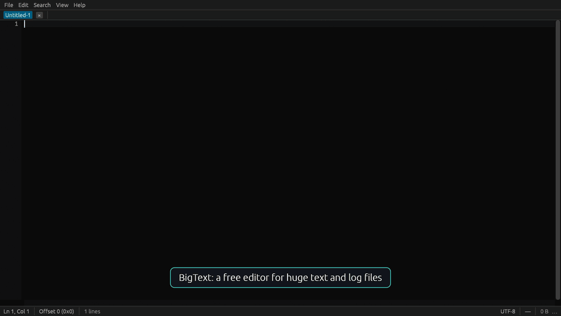
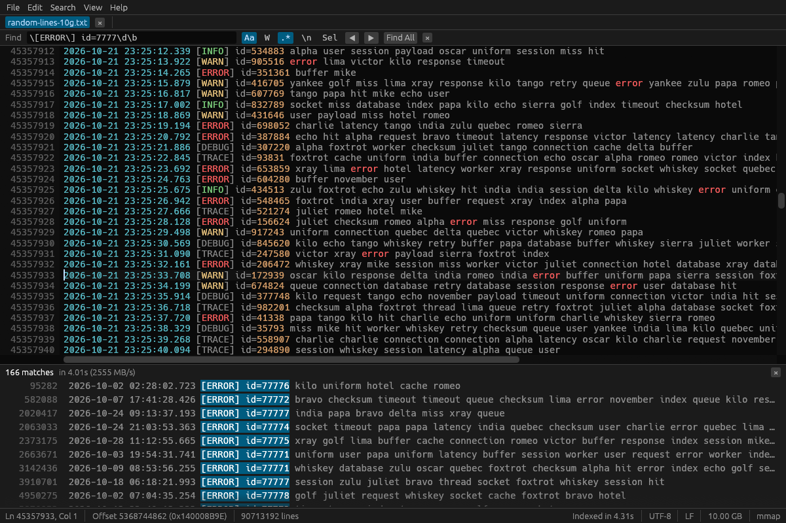
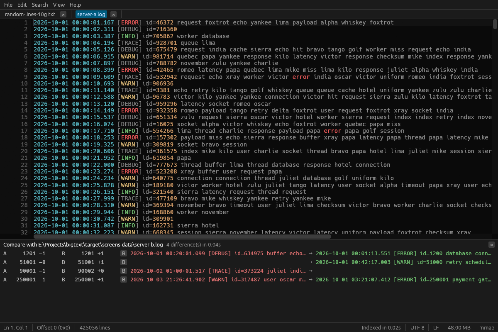
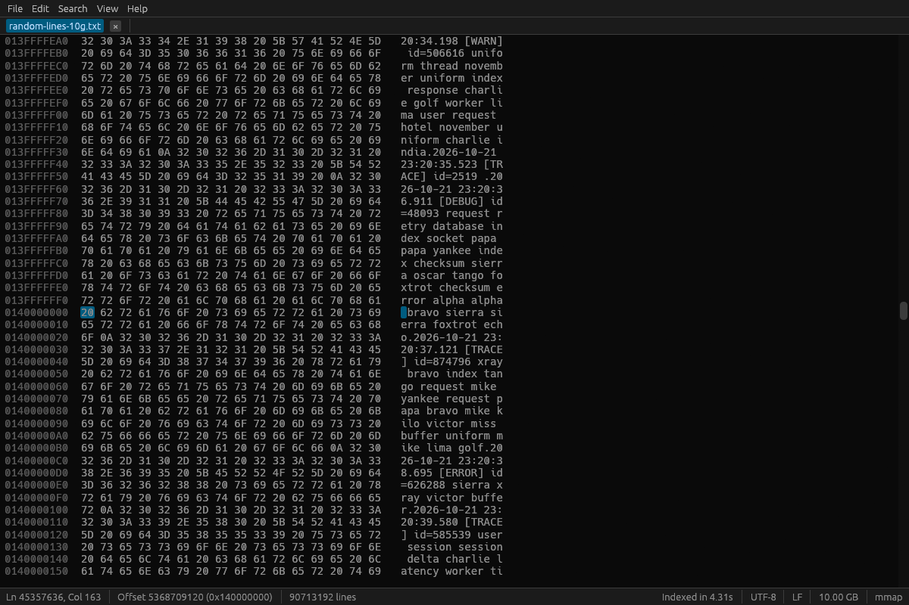
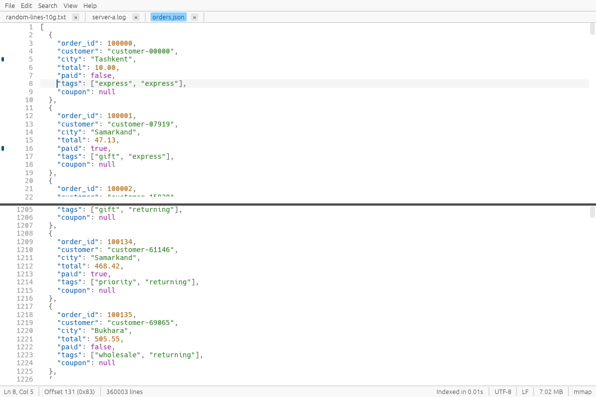

# BigText — open 50 GB text and log files instantly, free

[](https://github.com/Erkinbek/bigtext/actions/workflows/build.yml)
[](https://github.com/Erkinbek/bigtext/releases/latest)
[](LICENSE)
[](https://erkinbek.github.io/bigtext/)

**Open, search and edit 1 GB, 10 GB and 50 GB text and log files instantly.** BigText is a free,
open-source editor for **huge files** — logs, CSV exports, SQL dumps, JSON — that never freezes
and never loads a whole file into memory: a free alternative to EmEditor and UltraEdit, for
Windows, Linux and macOS. Written in Rust, it is one self-contained binary with no runtime
dependencies.

**[Download](#download)** · [Website](https://erkinbek.github.io/bigtext/) · [All features](FEATURES.md) · [Usage](USAGE.md) · [Русский](https://erkinbek.github.io/bigtext/ru/) · [O'zbekcha](https://erkinbek.github.io/bigtext/uz/) · [中文](https://erkinbek.github.io/bigtext/zh/) · [Español](https://erkinbek.github.io/bigtext/es/) · [Português](https://erkinbek.github.io/bigtext/pt/) · [Deutsch](https://erkinbek.github.io/bigtext/de/) · [Türkçe](https://erkinbek.github.io/bigtext/tr/)



## Highlights

- **Any size opens instantly.** A 50 GB file shows its first screen in under 50 ms and stays at
  about 100 MB of memory. The line index builds in the background, and go to line works before
  it finishes.
- **Search at 2.5 GB/s.** Plain text or regex, Find All, a filter view that works like `grep`,
  and Replace All streamed through a 10 GB file with bounded memory.
- **Real editing, safe saving.** Undo, multiple cursors, column selection, and sorting and text
  operations on files of any size. Saves write a temporary file and replace the original
  atomically, and a recovery journal brings unsaved edits back after a crash.
- **Made for logs.** Follow mode like `tail -F` — with alerts: a system notification and a sound
  when a line like `ERROR|FATAL` arrives — go to a time, a level bar, a time histogram, logs
  merged by time, and message patterns that group lines by template.
- **Web server logs, summed up.** nginx and Apache access logs, AWS load balancer logs, IIS logs
  and syslog open as a table with a column per field, and **Search → Web log report…** gives the
  top URLs, the 5xx errors per minute and the slowest requests from one pass (a 1 GB log in under
  2 seconds); a click shows the requests behind a number.
- **Tables and JSON.** CSV and TSV files open as tables with sorting, statistics, pivots and
  joins. JSON gets a structure view, folding and queries over JSON Lines.
- **Compare, hex and archives.** A streaming diff of two huge files, a hex view, and `.gz`,
  `.zst`, `.xz`, `.bz2`, `.zip` and `.tar` files opened without unpacking them by hand.
- **Logs on servers, without downloading them.** Open `user@server:/var/log/app.log` over SSH
  with your keys, or an `https://` or public `s3://` file (**Ctrl+Shift+U**): only what is on
  screen comes over, and over SSH searches run on the server. Or follow a log's last megabytes
  like `tail -F` (`bigtext -f user@server:/var/log/syslog`).
- **Container and service logs.** Pick a Docker container, a Kubernetes pod (or its run before
  the last crash) or a systemd service from a list, here or on a server over SSH, and its log
  opens and follows as it grows — no `docker logs -f … | bigtext -` to type.
- **Also a comfortable code editor.** Python, JavaScript, TypeScript, Java, C#, C/C++, Go, Rust,
  PHP, shell scripts, YAML and more are highlighted in One Dark, Monokai, GitHub or Solarized
  colours with indent guides; a folder side bar works as in Sublime Text; **Ctrl+P** finds a
  file, **Ctrl+R** lists functions and classes, **Ctrl+/** comments lines out, and brackets close
  themselves. Only the rows on screen are coloured, so a huge file stays just as fast.
- **Eight interface languages.** English, Russian, Uzbek, Chinese, Spanish, Portuguese, German
  and Turkish; a first start picks the system's language.

Scripts get the same streaming code without a window in `bigtext-cli` (see [USAGE.md](USAGE.md)).
Every feature is described in [FEATURES.md](FEATURES.md).

## Download

Latest release: [all files and release notes](https://github.com/Erkinbek/bigtext/releases/latest) · [changelog](CHANGELOG.md) · [Privacy](#privacy)

| Platform | Download |
| --- | --- |
| Windows 10 / 11 | [Installer](https://github.com/Erkinbek/bigtext/releases/latest/download/bigtext-setup-windows-x64.exe) (adds “Open with” and an Explorer context-menu entry) · [portable .zip](https://github.com/Erkinbek/bigtext/releases/latest/download/bigtext-windows-x64.zip) (unsigned: SmartScreen may ask, **More info → Run anyway**) |
| Linux x64 | [AppImage](https://github.com/Erkinbek/bigtext/releases/latest/download/bigtext-linux-x64.AppImage) · [.deb](https://github.com/Erkinbek/bigtext/releases/latest/download/bigtext-linux-x64.deb) (Debian, Ubuntu) · [.tar.gz](https://github.com/Erkinbek/bigtext/releases/latest/download/bigtext-linux-x64.tar.gz) |
| macOS | BigText.app for [Apple Silicon](https://github.com/Erkinbek/bigtext/releases/latest/download/bigtext-macos-arm64.app.zip) · [Intel](https://github.com/Erkinbek/bigtext/releases/latest/download/bigtext-macos-x64.app.zip); plain binaries: [Apple Silicon](https://github.com/Erkinbek/bigtext/releases/latest/download/bigtext-macos-arm64.tar.gz) · [Intel](https://github.com/Erkinbek/bigtext/releases/latest/download/bigtext-macos-x64.tar.gz) (unsigned: right-click → Open on first launch) |

With a package manager:

| Package manager | Command |
| --- | --- |
| [Scoop](https://scoop.sh/) (Windows) | `scoop bucket add bigtext https://github.com/Erkinbek/scoop-bigtext`, then `scoop install bigtext/bigtext` |
| [Homebrew](https://brew.sh/) (macOS, Linux) | `brew install erkinbek/tap/bigtext`; the macOS app: `brew install --cask erkinbek/tap/bigtext-app` |
| Cargo (any platform) | `cargo install bigtext` ([crates.io](https://crates.io/crates/bigtext); on Linux, first install the packages listed under [Building](CONTRIBUTING.md#linux)) |

Or build it yourself (see [Building](CONTRIBUTING.md#building)).

## How it compares

Notepad++ and VS Code read the whole file into memory, so a 10 GB log needs at least 10 GB of
free RAM. The editors built for huge files are paid, Windows-only or read-only: EmEditor runs
only on Windows and its free edition is for home and school use, UltraEdit is a paid
subscription, and klogg views and searches files without editing them. BigText opens, searches
**and edits** files of any size on Windows, Linux and macOS, and it is free and open source.

| Editor | Price | Open source | Platforms | A 10 GB file | Editing huge files |
| --- | --- | --- | --- | --- | --- |
| **BigText** | Free | ✅ MIT | Windows, Linux, macOS | ✅ Reads only the part on screen, about 100 MB of RAM | ✅ Streaming replace, atomic save |
| EmEditor | Paid (free edition for home and school use only) | ❌ | Windows | ✅ | ✅ |
| UltraEdit | Paid subscription | ❌ | Windows, Linux, macOS | ✅ | ✅ |
| klogg | Free | ✅ GPL-3.0 | Windows, Linux, macOS | ✅ | ❌ Views and searches only |
| Notepad++ | Free | ✅ GPL | Windows | ⚠️ Loads the whole file into RAM; the 32-bit build refuses files over 2 GB | ⚠️ Only what fits in RAM |
| VS Code | Free | ✅ MIT (Code - OSS) | Windows, Linux, macOS | ⚠️ Loads the whole file into RAM | ⚠️ Only what fits in RAM |

<sub>Checked in November 2026 against each project's own pages:
[EmEditor](https://www.emeditor.com/) and [EmEditor Free](https://www.emeditor.com/text-editor-features/emeditor-free/),
[UltraEdit large files](https://www.ultraedit.com/support/tutorials-power-tips/ultraedit/large-file-handling/),
[klogg](https://github.com/variar/klogg),
[Notepad++ file loading](https://github.com/notepad-plus-plus/notepad-plus-plus/blob/master/PowerEditor/src/ScintillaComponent/Buffer.cpp),
[VS Code text buffer](https://code.visualstudio.com/blogs/2018/03/23/text-buffer-reimplementation).
Something out of date? [Open an issue](https://github.com/Erkinbek/bigtext/issues).</sub>

## Screenshots

| Regex search over 10 GB (2.5 GB/s) | Comparing two logs |
| --- | --- |
|  |  |
| **Hex view in the middle of a 10 GB file** | **Light theme, JSON, split view, bookmarks** |
|  |  |

The screenshots are made by the app itself: `bigtext --screenshots DIR testdata/random-lines-10g.txt`.

## Usage

```
bigtext app.log:120                                     open a file at line 120
bigtext --find ERROR app.log                            open it and search
journalctl -f | bigtext -                               follow standard input
bigtext-cli filter -i timeout app.log -o timeouts.log   save the matching lines
```

The full command line, every `bigtext-cli` command and the keyboard shortcuts are in
[USAGE.md](USAGE.md).

## Measured performance

Measured on Windows 11 Pro, Intel Core Ultra 9 285 (24 cores), 191 GB RAM, release build,
files already in the OS page cache ("cached data" as in the targets). GUI numbers come from
`bigtext --bench-ui` (frame time = CPU time of one egui frame including our layout); core numbers
from `bigtext-bench`. Raw reports: `scripts/bench.ps1` reproduces them.

### Targets

| Target | Goal | Measured | |
|---|---|---|---|
| Open → first screen of text | < 200 ms | 41–46 ms in the GUI (1 GB … 50 GB, incl. waiting for the next frame); open + detect on the worker 1.2–2.4 ms; first-screen layout 0.03 ms | ✅ |
| Jump to line, indexed (10 GB / 50 GB) | < 50 ms | frame incl. jump + layout: avg 0.86 / 0.88 ms, max 1.31 / 1.22 ms; core lookup + 50-row layout avg 0.07 ms | ✅ |
| Jump to line before indexing (estimate) | < 500 ms | frame avg 1.40 / 1.60 ms, max 1.82 / 2.01 ms (refined automatically when the index arrives) | ✅ |
| UI frame time while indexing / scrolling | < 16 ms | page-down every frame while indexing 50 GB: avg 0.83 ms, p99 1.16 ms, max 1.88 ms (600 frames); 2 GB single line: max 2.68 ms | ✅ |
| Literal search throughput | ≥ 1 GB/s | 2.4–2.5 GB/s (10 GB, 50 GB), 4.4 GB/s (2 GB line), case-insensitive 1.7–2.1 GB/s | ✅ |
| Simple regex throughput | ≥ 200 MB/s | `id=99\d{4} ` 2.3–2.8 GB/s, `ERROR\] id=\d+ timeout` 2.3 GB/s, no-literal `[a-z]{9,} [a-z]{9,}` 672 MB/s; decoded UTF-16 / cp1251 regex 390 / 248 MB/s | ✅ |
| Replace All on 10 GB, private memory | < 300 MB | 22.2 M replacements, 10 GB written in 11.3 s (904 MB/s incl. fsync), peak private 46 MB | ✅ |
| Idle private memory, 50 GB file open | < 200 MB | 107 MB in the GUI after indexing (≈95 MB of it is the GUI/GL baseline); core process 12 MB | ✅ |
| Startup → first paint | < 300 ms | 159–185 ms (process start → end of first frame) | ✅ |

### Details

| File | Index time (throughput) | Index memory | Lines |
|---|---|---|---|
| random-lines-1g.txt | 0.45 s (2.3 GB/s) | 130 KB | 9,069,553 |
| random-lines-10g.txt | 4.1–4.3 s (2.4–2.5 GB/s) | 2.0 MB | 90,713,192 |
| random-lines-50g.txt | 19.2–23.1 s (2.2–2.7 GB/s) | 8.1 MB (0.016 % of file) | 453,565,956 |
| single-line-2g.txt | 0.76 s (2.7 GB/s) | 260 KB | 1 |
| short-lines-100m.txt | 0.18 s (2.6 GB/s) | 65 KB | 100,000,001 |
| utf16le.txt (64 MB) | 0.02 s | 8 KB | 690,320 |
| cp1251.txt (64 MB) | 0.03 s | 8 KB | 1,091,711 |

- Chunked fallback (forced, 1 GB): first screen 3.1 ms, search 3.0–3.6 GB/s, private memory
  67 MB (64 MB block cache).
- 2 GB single line: page-down frames avg 1.87 ms, go-to 0.45 ms, search finds the marker in the
  middle at 4.4 GB/s.
- Save of an edited 1 GB file (edit at the top while indexing was still running): 0.9–1.1 s for
  write + fsync + atomic replace + reopen.
- Memory design note: mapping a whole 50 GB file on Windows commits ~100 MB up front (file
  size / 512), so the UI maps a small LRU cache of 288 MB views and workers stream with
  positional reads into reused buffers. That keeps memory flat, and makes indexing faster than
  first-touch page faults (2.4 vs 1.6 GB/s); repeated searches run at ~2.4 GB/s instead of the
  ~10 GB/s an already-faulted full mapping would allow.

## Documentation

- [FEATURES.md](FEATURES.md): every feature in detail, and the known limitations.
- [USAGE.md](USAGE.md): the command line, `bigtext-cli` and the keyboard shortcuts.
- [CONTRIBUTING.md](CONTRIBUTING.md): building, architecture, tests, the website and releasing.
- [CHANGELOG.md](CHANGELOG.md): what changed in each release.
- Guides on the website: [a CSV past Excel's 1,048,576 rows](https://erkinbek.github.io/bigtext/guides/open-csv-larger-than-excel/),
  [a 10 GB log file](https://erkinbek.github.io/bigtext/guides/open-large-log-file/),
  [one table out of a mysqldump](https://erkinbek.github.io/bigtext/guides/extract-table-from-mysqldump/).

## Privacy

This program will not transfer any information to other networked systems unless specifically
requested by the user or the person installing or operating it.

- **Update check**: only when you ask for it (**Help → Check for updates…**), or once a day if
  you agreed to automatic checks when BigText first started (the Help menu changes this). The
  request goes to GitHub's API (`api.github.com`) and carries BigText's version; nothing about
  you or your files. **Update now** downloads the new version from GitHub. GitHub's
  [privacy statement](https://docs.github.com/en/site-policy/privacy-policies/github-general-privacy-statement)
  applies to these requests.
- **Remote files**: **Open remote file or URL…** connects only to the server or address you
  type, with your own `ssh` and keys for SSH.
- BigText collects no telemetry, usage statistics or crash reports.

## Author

**Erkin Pardayev**

- GitHub: [github.com/Erkinbek](https://github.com/Erkinbek)
- Repository: [github.com/Erkinbek/bigtext](https://github.com/Erkinbek/bigtext)
- Telegram: [@ErkinPardayev](https://t.me/ErkinPardayev)
- E-mail: [erkin.pardayev@gmail.com](mailto:erkin.pardayev@gmail.com)

Licensed under the [MIT license](LICENSE).
