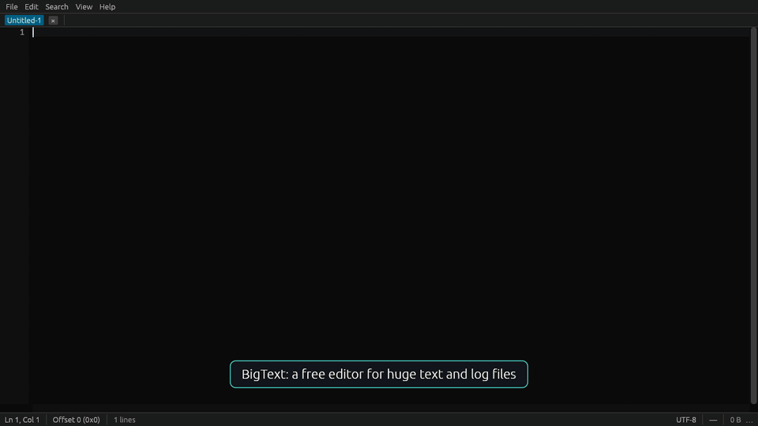

# Open in BigText

Open huge files and logs from VS Code in [BigText](https://erkinbek.github.io/bigtext/), the
free, open-source editor that opens 1–50+ GB text files at once and never loads them into
memory.

VS Code is great for code, but a multi-gigabyte log, CSV export or SQL dump is either refused
("the file is not displayed in the text editor because it is very large") or loaded into
memory. This extension hands such files to BigText in one click.

## Features

- **Open in BigText** in the Explorer's context menu, on an editor tab and in the editor's
  context menu. From the editor, BigText opens the file at the line the caret is on.
- **Open Folder in BigText** for a folder in the Explorer (or the workspace, from the command
  palette): BigText shows its files in its side bar.
- When VS Code opens a file larger than 50 MB (the `bigtext.suggestAboveMB` setting), the
  extension offers to open it in BigText instead, also when VS Code refuses to show it.
- Files go to the BigText window that is already open.

## Requirements

[BigText](https://erkinbek.github.io/bigtext/#download) itself, for Windows, Linux or macOS. The
extension finds it where its installer, Scoop, Homebrew, the `.deb` package, the AUR package or
`cargo install` put it, or on the `PATH`. For an AppImage or a portable copy, set its path:

| Setting | Default | |
| --- | --- | --- |
| `bigtext.path` | empty | The BigText program, e.g. `C:\Tools\BigText\bigtext.exe` or `~/Apps/bigtext.AppImage` |
| `bigtext.suggestAboveMB` | `50` | Offer BigText for files larger than this; `0` turns the offer off |

## About BigText

BigText reads only what is on screen: a 50 GB log opens at once and uses about 100 MB of memory.
It searches at several GB/s, follows growing logs like `tail -F`, opens CSV files as tables,
compares huge files and saves edits atomically. It is free under the MIT license.

[Website](https://erkinbek.github.io/bigtext/) ·
[Source and issues](https://github.com/Erkinbek/bigtext)
